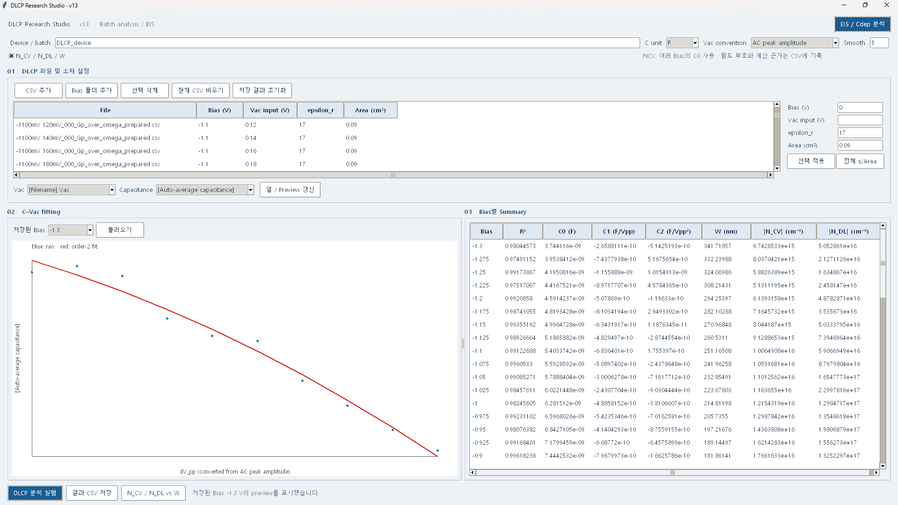
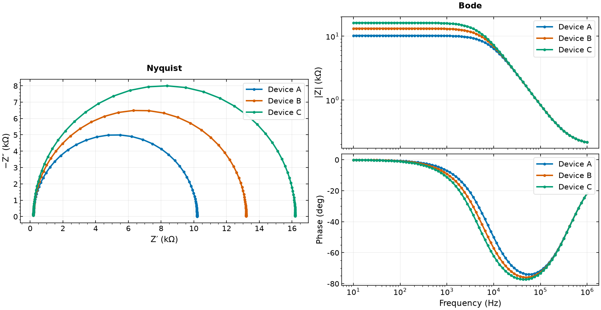

# CQD Research Software Toolkit

CQD 광검출기 연구의 **측정 → 분석 → 시각화** 작업을 개선하기 위해 개발한 Windows 연구용 소프트웨어 3종입니다. 반복 측정과 데이터 처리의 문제를 직접 요구사항으로 정리하고, AI 코딩 도구를 활용해 구현·검증·배포를 진행했습니다.

## 프로그램과 다운로드

| 프로그램 | 배포 버전 | 주요 역할 | Windows ZIP |
|---|---|---|---|
| DLCP Research Studio | 17.2 | DLCP 계산, EIS 등가회로 피팅과 진단 | [다운로드](https://github.com/shinchan394/dlcp-batch-analyzer/releases/download/research-toolkit-2026-10-16/DLCP_Research_Studio_V17_2_Windows.zip) |
| MFIA DLCP Control | 1.4 | Zurich MFIA 조건별 DLCP 자동 취득 | [다운로드](https://github.com/shinchan394/dlcp-batch-analyzer/releases/download/research-toolkit-2026-10-16/MFIA_DLCP_Control_1_4_Windows.zip) |
| Measurement Plot Studio | 2.1.1 | CSV 오버레이와 그래프 저장 | [다운로드](https://github.com/shinchan394/dlcp-batch-analyzer/releases/download/research-toolkit-2026-10-16/Measurement_Plot_Studio_2_1_1_Windows.zip) |

위 다운로드는 해당 Release가 공개된 뒤 사용할 수 있습니다. ZIP을 모두 압축 해제하고 내부 실행 안내를 따르세요. Python 설치는 필요 없습니다. PLOT은 EXE와 `_internal` 폴더를 함께 유지해야 합니다.

이 저장소는 **현재 배포본과 사용 안내 중심**으로 정리했습니다. 과거 V7 실행파일·코드·빌드 예제는 현재 트리에서 제거했습니다. Git 기록은 보존하며, 최신 프로그램의 소스 코드는 이번 공개 범위에 포함하지 않습니다.

[개발 경험과 문제 해결](docs/PORTFOLIO_KO.md) · [사용 방법과 검증 범위](docs/PROGRAMS_KO.md) · [Release](https://github.com/shinchan394/dlcp-batch-analyzer/releases/tag/research-toolkit-2026-10-16)

[설명서와 이미지 ZIP 다운로드](https://github.com/shinchan394/dlcp-batch-analyzer/releases/download/research-toolkit-2026-10-16/CQD_Research_Toolkit_Docs_2026-10-16.zip)

## 개발 과정과 출력 예시

2026-09-07 발표에 포함된 **당시 DLCP v13 실행 화면**입니다. CSV 입력, 피팅, Bias별 결과를 한 화면에 통합한 개발 과정을 보여주며 최신 V17.2 화면으로 표시하지 않습니다.

**PLOT 2.1.1 검증 과정에서 저장한 합성 데이터 출력**입니다. 실제 측정 결과나 프로그램 창 전체의 스크린샷이 아닙니다. [이미지 출처와 확인 범위](docs/SCREENSHOTS_KO.md)를 함께 제공합니다.

## 연구에서 발견한 문제

바이어스와 AC amplitude 조건이 늘어나면 장비 설정, CSV 정리, 개별 피팅과 그래프 저장을 반복해야 합니다. 수작업 시간이 길어지고 단위·파일 선택·계산 조건을 일관되게 관리하기 어려워, 각 작업을 재사용할 수 있는 소프트웨어로 연결했습니다.

1. **자동 측정:** 측정 계획에 따라 MFIA로 데이터를 취득하고 조건별로 저장합니다.
2. **분석:** DLCP 다항식 피팅과 농도·폭 계산, EIS 등가회로 피팅 및 진단 결과를 확인합니다.
3. **시각화:** 결과 CSV를 조건별로 겹쳐 보고 발표·보고서용 그래프와 설정을 저장합니다.

## 개발 역할과 AI 활용

연구 과정의 반복 작업과 오류 가능성을 발견하고, 필요한 측정 순서·단위·출력 항목을 정했습니다. AI를 코드 구현과 디버깅에 활용하고 테스트 및 실제 연구 사용 중 발견한 문제를 바탕으로 수정했습니다. 연구 문제의 정의, 실험 조건의 선택과 결과의 물리적 해석은 연구자가 판단해야 하는 부분으로 구분했습니다.

## 검증 근거

| 프로그램 | 확인한 내용 | 한계 |
|---|---|---|
| 분석 17.2 | 2026-10-08 Windows 테스트 73개 통과. EXE의 합성 2바이어스 피팅·GUI 선택 항목·내보내기 검사 통과 | Cj/Cother의 물리적 분리는 식별 가능성이 확보돼야 함 |
| 자동 측정 1.4 | 패키지 기록: 테스트 74개 통과, 1개 skip. 사용자 보고: 610포인트 약 75분 취득 사례 | 빌드 환경의 EXE GUI 검증은 Tcl 접근 오류로 미완료. 모든 장비 조건의 검증은 아님 |
| PLOT 2.1.1 | 테스트 33개, GUI·이미지 저장 검증 및 EXE 자가검사 통과 | 사용자 PC마다 실행 여부는 별도 확인 필요 |

약 75분과 과거 약 101분의 측정 사례는 통제된 성능 비교가 아니므로 SW 단독의 개선율로 표현하지 않습니다. R²는 피팅 적합도이며 측정 정확도의 보증값이 아닙니다. EIS의 좋은 피팅만으로 특정 계면·트랩의 기여를 확정하지 않습니다.

배포본에는 원본 연구 데이터, 장비 접속 설정과 내부 실행 로그를 포함하지 않습니다. 공개용 ZIP은 기존 EXE를 유지하고 필수 실행 리소스·사용 안내·검증 요약만 포함하도록 다시 구성했습니다. MFIA 1.5 원격 모니터링 개발본은 이번 배포 대상에 포함하지 않았습니다.
